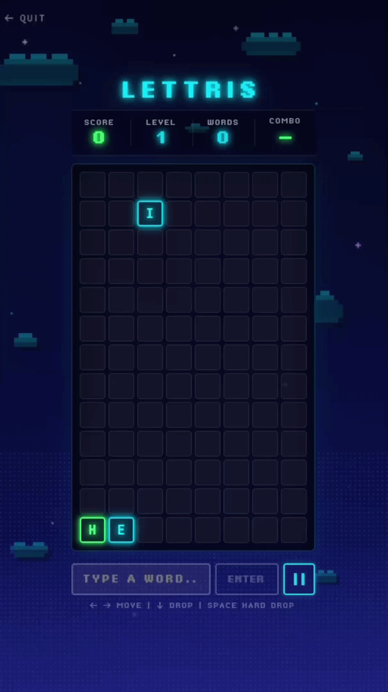

# Lettris

**Tetris meets word game.** Letters fall from the sky — you move them into place, then type a word to clear them. Simple idea, surprisingly hard to put down.

---

## Game demo



---

## How it works

Letters drop one at a time into an 8-column grid. Use the arrow keys to position them, then type any word you can spot on the board and hit Enter to clear those letters. The grid fills up faster as you level up, so you'll need to think and type quickly.

**Controls**

| Key | Action |
|-----|--------|
| `← →` | Move falling letter |
| `↓` | Speed up |
| `Space` | Hard drop |
| Any letter | Start typing a word |
| `Backspace` | Delete last letter |
| `Enter` | Submit word |
| `Esc` | Pause / resume |

No clicking required to switch between moving and typing — just start typing and it works.

---

## Scoring

- Longer words = exponentially more points (score = length² × 10)
- Clear words quickly back-to-back to build a **combo multiplier** (up to ×2.5)
- Words up to 8 letters are valid

**Vowels** show up in cyan, **consonants** in green — helpful for spotting words fast.

---

## Features

- 🏆 Leaderboard — scores saved locally, top 10 tracked per browser
- 👤 Name entry — enter once, remembered forever
- 🎵 Background music + sound effects
- Pixel art background with shooting stars on the start screen
- Combo animations, word clear animations

---

## Running locally

```bash
npm install
npm run dev
```

Built with React + Vite.
